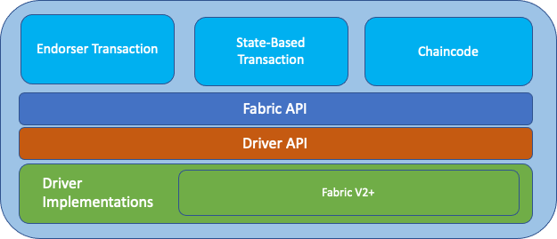

# The Fabric SDK

This is the `Fabric SDK` stack:

It consists of the following layers:

- `Services` (light-blue boxes): Services offer access to Fabric-specific
  functionality, such as transaction endorsement, state-based endorsement, and
  the execution of Chaincode.
- `Fabric API`: This API follows the same abstraction paradigm as the `View API`
  but provides Fabric-specific functionality to enable `FSC nodes` to
  communicate with Fabric. Even though this API is specific for Fabric, it
  abstracts away certain details when dealing with a specific Fabric version.
- `Driver API`: This API translates the `Fabric API` to a concrete driver
  implementation.
- `Driver Implementations`: The Fabric SDK comes with a driver implementation
  for Fabric V2+.

## Messages between nodes

The endorser views (`platform/fabric/services/endorser`) and the state views
(`platform/fabric/services/state`) exchange transactions, endorsement responses
and finality requests with other nodes. Their formats are versioned per session
through the `fabric` component (Fabric networks) and the `fabricx` component
(Fabric-x networks); FSC supports version 2 of both, so a session with a node of
a release that supports only version 1 is refused (see
[Format negotiation](../view/services/comm/readme.md#format-negotiation)). A
node sends the version 2 forms on every session, and reads both: the senders do
not ask the session for its version, so a session that is not an FSC network
session, such as an in-process one, gets them too, although
`view.SessionVersion` reports version 1 on it. The messages are defined in
`platform/fabric/protos/fabric.proto` (package `fsc.fabric.v1`) and
`platform/fabricx/protos/fabricx.proto` (package `fsc.fabricx.v1`); they only
gain fields, and `make buf-breaking` checks this.

| Message                                                                                                                                  | Version 1, read only                                                                                        | Version 2, sent and read       |
| ---------------------------------------------------------------------------------------------------------------------------------------- | ----------------------------------------------------------------------------------------------------------- | ------------------------------ |
| Transaction, as `endorser.NewCollectEndorsementsView`, `NewParallelCollectEndorsementsOnProposalView` and the `state` send views send it | JSON of `Transaction.Bytes`                                                                                 | protobuf `TransactionEnvelope` |
| Endorsement response                                                                                                                     | JSON array of marshaled `ProposalResponse`s, or a JSON `endorser.Response` for an endorsement on a proposal | protobuf `EndorsementResponse` |

A sender converts the transaction's JSON with `endorser.WireBytes` just before
it sends it, so hashing, storing and decoding on each node keep working on the
JSON, and a responder answers with an `EndorsementResponse`. A receiver reads
both forms, telling them apart by the first byte: `{` is JSON and `0x0a` is an
envelope (the tag of its `platform` field, which is never empty); any other
first byte is an error. An endorsement response that starts with `[`, `{` or `n`
is JSON, anything else is an `EndorsementResponse`. A transaction on a network
whose driver registers no transaction format has no envelope: it is sent, and
answered, as JSON.

### Collecting endorsements

`endorser.NewCollectEndorsementsView`, which `state.NewCollectEndorsementsView`
wraps, asks each party in turn for its endorsement and stops at the first one
that fails. Its error tells a caller whether the party was unavailable, so that
an application with several endorsers can try the next one. It matches, with
`errors.Is`:

| Failure                                                                                                  | Error                                                                                                                                                                                                                                            |
| -------------------------------------------------------------------------------------------------------- | ------------------------------------------------------------------------------------------------------------------------------------------------------------------------------------------------------------------------------------------------ |
| The party rejected the session, for example because it drains, is busy, or has no responder for the view | the rejection's sentinel, such as `session.ErrDraining`, `session.ErrBusy` or `session.ErrUnknownView`, and `session.ErrRejected` (see [Error replies a node sends unasked](../view/services/comm/readme.md#error-replies-a-node-sends-unasked)) |
| The session closed before the party answered                                                             | `comm.ErrSessionClosed`                                                                                                                                                                                                                          |
| The party did not answer within a minute                                                                 | `context.DeadlineExceeded`                                                                                                                                                                                                                       |
| The view's context ended first                                                                           | the context's error                                                                                                                                                                                                                              |
| The transaction could not be sent, for example to a node that is down                                    | the send's error, such as a dial error wrapping `syscall.ECONNREFUSED`                                                                                                                                                                           |

An error reply that is not a rejection, and an endorsement that does not verify,
wrap none of these.

The view adds each endorsement to the transaction as soon as it verifies, this
node's own included, and a failure does not remove the ones added before it. A
party that fails before its reply verifies, which includes every failure in the
table above, adds nothing, so a caller that asks one party at a time can pass
the same transaction to another party. An endorsement already on the transaction
is not added a second time.

#### Several endorsers that each satisfy the policy

An application can spread its transactions over several endorser nodes,
without replicas or a load balancer, when any one of them satisfies the
namespace's endorsement policy, such as `OutOf(1, 'Org2MSP.member')`. Each
endorser is a separate FSC node, with its own identity and database. For each
transaction, the initiator endorses first, which signs the proposal the
endorsers endorse: a transaction whose endorsements lack that proposal cannot
be ordered. It then asks one endorser at a time, each under a deadline of its
own that it passes with `view.WithGoContext`. When the endorser is unavailable,
it asks the next one with the same transaction. Unavailable means a rejection,
a closed session or the deadline from the table above, or a dial error: the
connection is refused (`syscall.ECONNREFUSED`), or the handshake of a new
connection outlasts the deadline (`os.ErrDeadlineExceeded`).

An endorser the initiator gave up on does not answer. A request that reached
it runs in the context of the initiator's session, which ended when the
initiator moved on, so the endorsement is neither stored nor sent. On Fabric,
an endorser's vault commits only the transactions it has a record of, such as
those it endorsed, unless a rule selects more, such as a namespace its
committer processes (`Committer.ProcessNamespace`). If its responder marks the
transaction `Busy` before the transaction's block arrives, the block commits
it; otherwise the endorser keeps no record of it. A responder that marks it
`Busy` after the block keeps it `Busy`
([#2618](https://github.com/hyperledger-labs/fabric-smart-client/issues/2618)).
On Fabric-x, every node reads statuses and state from the committer.

The views in
[`integration/fabric/common/endorsers/views`](../../../integration/fabric/common/endorsers/views/views.go)
follow this pattern, and the `fabric-endorsers` and `fabricx-endorsers`
integration suites run it.

### The transaction envelope

A `TransactionEnvelope` carries what the receiver needs to pick the local
network and channel before it decodes the transaction:

- `platform`: the driver name of the sender's network, `generic` for Fabric and
  `fabricx` for Fabric-x. It selects the format of `payload`.
- `channel_genesis_hash` and `channel`: the channel key. The receiver routes the
  transaction to the local network that has a channel with this name and genesis
  hash, as it does for the key in a JSON transaction. Without a genesis hash it
  uses its default network.
- `network_hint`: the sender's name for its network, for logs only.
- `payload`: the transaction in the platform's format, a
  `fsc.fabric.v1.Transaction` for Fabric and a `fsc.fabricx.v1.Transaction` for
  Fabric-x. Signed proposals and proposal responses are carried as marshaled
  messages. The bytes their signatures cover, and the signatures, are kept byte
  for byte: the `proposal_bytes` and `signature` of the signed proposal, and the
  `payload` and `endorsement` of each proposal response. The outer messages are
  marshaled again, so their bytes can differ from the ones the signer produced;
  no signature covers them.

Each platform owns its payload format: `platform/fabric/protos` holds the Fabric
format and a registry (`RegisterTransactionFormat`), and
`platform/fabricx/protos` registers the Fabric-x format in an `init` function. A
format also tells the endorser whether to check that the txID is derived from
nonce and creator (`SkipTxIDCheck`, set for Fabric-x; see
[Fabric security](security.md#data-received-from-peers)). A receiver refuses an
envelope whose platform has no registered format, whose `channel` differs from
the channel header of the signed proposal, or whose platform differs from the
driver of the network that decodes it.

The conversion is exact or fails. `protos.EnvelopeFromJSON` refuses JSON it
cannot carry without loss: a field the transaction JSON does not have, trailing
data, a Fabric transaction type other than endorser transaction, and a
transaction without a txID. A transaction type that adds JSON fields of its own
to FSC's therefore fails to send. The proposal (`TProposal`) is not carried: the
receiver rebuilds it from the signed proposal.

### Finality requests

`endorser.FinalityViewFactory` builds a finality view from the JSON of
`endorser.Finality` or from a protobuf `FinalityRequest`; input whose first byte
is `{` is JSON, and any other input is a `FinalityRequest`. JSON with leading
whitespace is refused: the first byte of a `FinalityRequest`, `0x0a`, is also a
newline, so a client sends the JSON as `json.Marshal` gives it. A
`FinalityRequest` with a channel genesis hash also names the platform, and the
view routes it to the local network that has that channel, as for a received
transaction. Without a genesis hash it runs on the default network. This input
comes from a client, not from a session, so it is not versioned.

### Stored transactions and metadata

The endorse-tx store (`fsc_default_etx`), which `fabric.Vault.StoreTransaction`
and the endorser write and `LoadTransaction` reads, holds JSON until its
contract step 2 has run and `TransactionEnvelope`s afterwards. The vault stores
each state's metadata gob-encoded until its contract step 2 has run and as a
protobuf `VaultMetadata` afterwards. Readers accept both forms in either case.
Decode a loaded transaction with the network's transaction manager
(`fabric.TransactionManager.NewTransactionFromBytes`), which accepts both forms,
never with `json.Unmarshal`. See
[Schema migrations](../view/services/schema-migrations.md#contract-steps) for
the steps.
