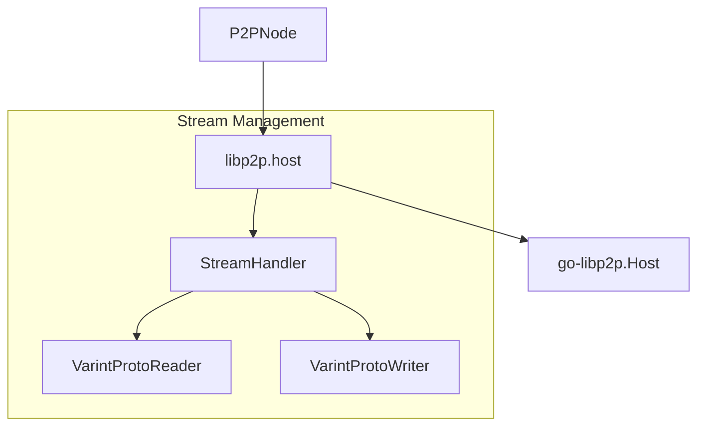

# libp2p transport

The libp2p transport is an optional communication stack for the Fabric Smart Client, distributed as its own Go module; the WebSocket transport is the primary implementation and lives in the root module. It uses the `libp2p` library for the connection, the security handshake and stream multiplexing.

## Overview

A libp2p node finds no peers on its own. To open a session it dials the P2P address that the endpoint resolver gives for the party, as a WebSocket node does, and a responder replies on the connection the initiator opened. A node therefore needs no other node to be up to start, and every resolver entry for a party the node opens sessions to needs a `P2P` address.

### Key characteristics
- **Addressing**: Peers are dialed at the address from the endpoint resolver; with no address the host uses one it already knows for the peer, such as from a live connection, and otherwise fails.
- **Transport**: TCP. The host does not reuse its listen port for outgoing connections, so two nodes that dial each other at the same moment get two connections instead of one that neither can secure.
- **Security**: Supports Noise and TLS security handshakes.
- **Identity**: Peer IDs are derived from the node's cryptographic public key.

## Internal architecture

The libp2p transport implementation is centered around the `libp2p.host` struct.

### Component diagram



### Message dispatching

When a new stream is opened to a node, libp2p triggers the registered stream handler:

1.  **Protocol Negotiation**: The requester offers `/fsc/view/2.0.0` and then `/fsc/view/1.0.0`; the receiver registers both, and libp2p picks the first one the receiver supports.
2.  **Preamble**: On `/fsc/view/2.0.0` each side writes one length-prefixed preamble frame and then reads the other's, within 30 seconds. The frame is read without a buffered reader, so the `ViewPacket`s that follow stay on the stream. A peer on another framing epoch gets its stream reset. On `/fsc/view/1.0.0` the stream carries no preamble. See [Stream preamble](./readme.md#stream-preamble).
3.  **Stream Wrapping**: The raw libp2p stream is wrapped into an `fsc.stream` object, which provides a unified interface for the Comm layer.
4.  **Peer Info Extraction**: The remote Peer ID and Multiaddress are extracted from the underlying connection.
5.  **Handling**: The `P2PNode` receives the new stream and starts a `streamHandler` goroutine to read `ViewPacket` messages.

## Security and identity

In libp2p mode, the `PeerID` is the primary identifier. 

-   **TLS Identity**: The transport uses the node's main identity key (configured via `fsc.identity.key.file`) for the security handshake.
-   **Handshake**: libp2p performs its own security handshake (Noise or TLS).
-   **Identity Binding**: The `PeerID` used by libp2p is cryptographically linked to the public key used during the handshake. The Comm layer uses `s.Conn().RemotePeer().String()` as the source of truth for the remote identity.

## Performance and hardening

-   **Connection Manager**: Configured with a "low water mark" of 100 and a "high water mark" of 400 connections to prevent resource exhaustion.
-   **Read Limits (OOM Protection)**: Incoming messages are limited by `fsc.p2p.maxRecvMsgSize` (default 10 MiB) to prevent remote memory exhaustion attacks. The system reads the varint-encoded length prefix and validates it before allocating the target buffer.
-   **Stream Sharing**: The `StreamHash` for libp2p is the `RemotePeerID`, so all sessions to a peer share its streams. Sessions that need a stream to a peer while there is none wait for one new stream instead of opening one each, which keeps a burst of new sessions under libp2p's limit of inbound streams per protocol and peer (by default 64, raised with the memory available). Closing a session does not close a shared stream, because the remote may still reply on it for another session. A shared stream is removed when reading from it fails (for example, the peer goes away or the connection is trimmed) and closed when the node stops.

## Trust and access control

In libp2p mode, nodes establish trust through the exchange of public keys:
- **Noise Handshake**: All connections use the Noise protocol (or TLS) where both sides exchange public keys.
- **Identity Verification**: The `PeerID` of the remote node is checked against the local node's trusted set (from static configuration or dynamic `EndpointService` resolutions).
- **Public Key Invariant**: The connection is only accepted if the remote party can cryptographically prove possession of the private key corresponding to its identity.

libp2p is configured via the `fsc.p2p` section in `core.yaml`. For a complete configuration reference, see [Configuration Guide](../../../../configuration.md).

```yaml
fsc:
  p2p:
    # Transport type must be "libp2p"
    type: libp2p
    # Address to listen for incoming libp2p connections
    # See https://github.com/libp2p/specs/blob/master/addressing/README.md
    listenAddress: /ip4/0.0.0.0/tcp/11511
    
    opts:
      # ------------------- libp2p specific options -------------------------
      libp2p:
        # Connection manager settings for libp2p
        connManager:
          # Low water mark - when the number of connections drops below this, the connection manager
          # will not prune any connections. Default: 100
          lowWater: 100
          # High water mark - when the number of connections exceeds this, the connection manager
          # will prune connections until it reaches the low water mark. Default: 400
          highWater: 400
          # Grace period - connections younger than this will not be pruned. Default: 60s
          # Format: duration in seconds
          gracePeriod: 60
  
  identity:
    key:
      # Path to the node's private key used for libp2p security handshake
      file: ./path/to/key.pem
```

## Code references

| Feature | File Path |
| :--- | :--- |
| Host Implementation | `platform/view/services/comm/host/libp2p/host.go` |
| Stream Wrapper | `platform/view/services/comm/host/libp2p/stream.go` |
| Configuration | `platform/view/services/comm/host/libp2p/provider.go` |
| Protobuf Reader | `platform/view/services/comm/io/reader.go` |
| Metrics | `platform/view/services/comm/host/libp2p/metrics.go` |

## Code walkthrough

- **Setup**: `NewHostGeneratorProvider` (`host/libp2p/provider.go`) holds the libp2p configuration; its `GetNewHost` loads the node's key and builds the libp2p host.
- **Incoming streams**: `host.Start` (`host/libp2p/host.go`) registers one stream handler for `/fsc/view/2.0.0` and `/fsc/view/1.0.0`. The handler wraps each stream, exchanges preambles and passes the stream to `P2PNode.handleIncomingStream` (`comm/p2p.go`).
- **Outgoing streams**: `P2PNode` opens a stream with `host.NewStream` (`host/libp2p/host.go`) when a session needs one to a peer.
- **Reading and writing**: `P2PNode.handleStream` (`comm/p2p.go`) wraps every stream, incoming or outgoing, in a `streamHandler` with a varint-delimited protobuf reader and writer (`comm/io`).
