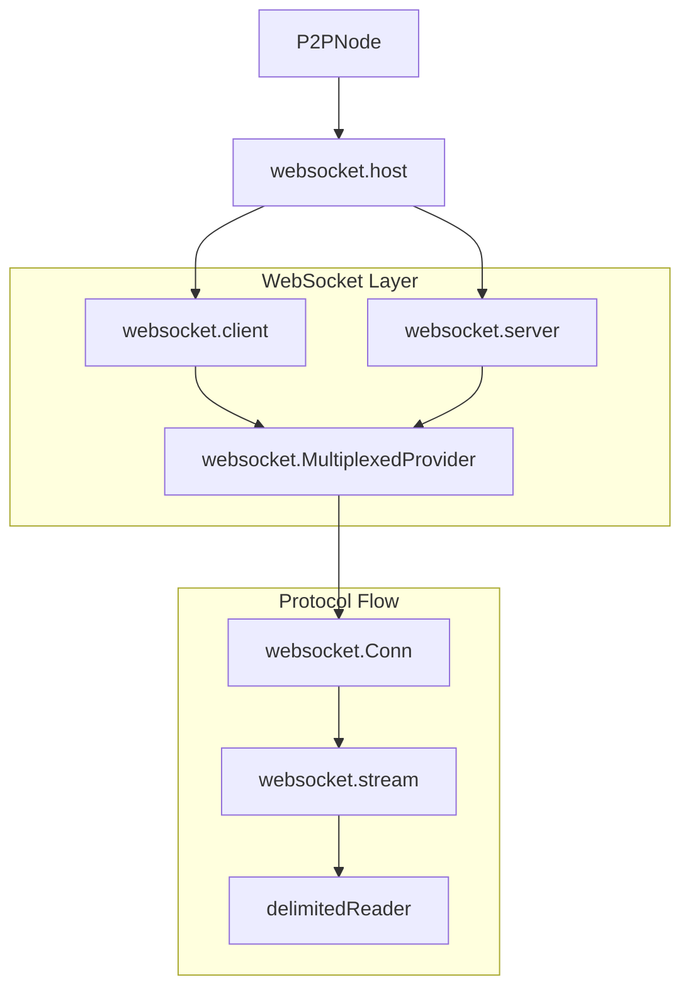

# WebSocket Transport

The WebSocket transport provides a secure, lightweight, and firewall-friendly communication channel. It uses standard HTTP/HTTPS for handshakes and then upgrades to WebSockets for full-duplex P2P communication.

## Overview

This transport is designed for deployments where standard web ports are preferred over custom P2P ports. It features built-in multiplexing to minimize the overhead of opening multiple connections between nodes.

### Key Characteristics
- **HTTPS Handshake**: Initial connection and authentication happen over standard HTTP(S).
- **WebSocket Upgrade**: Connections are upgraded to WebSockets for persistent, full-duplex messaging.
- **Multiplexing**: Multiple logical FSC streams are multiplexed over a single physical WebSocket.
- **Mutual TLS**: mTLS is mandatory and strictly enforced for both server and client authentication (`tls.RequireAndVerifyClientCert`).
- **TLS 1.3 Only**: Both server and client TLS configurations pin `MinVersion`/`MaxVersion` to `tls.VersionTLS13`; handshakes offering TLS 1.2 or lower are rejected.
- **Dynamic Port Assignment**: The transport supports starting on a dynamic port (by setting the port to `0` in `listenAddress`). The actual assigned port is automatically retrieved and used for service discovery and readiness checks.

## Internal Architecture

The WebSocket transport implementation is built on top of the standard Go `net/http` server and the `gorilla/websocket` library.

### Component Diagram



### Protocol Handshake and Upgrading

The steps below are those of the multiplexed provider, which nodes use. The test-only `SimpleProvider` skips the preamble steps 5 and 8 and sends no preamble.

1.  **TCP/TLS Connect**: The client establishes a TLS connection to the server's WEBSOCKET endpoint (e.g., `https://node-a:11511/p2p`).
2.  **mTLS Identity**: Both parties use the node's main identity (configured via `fsc.identity.key.file` and `fsc.identity.cert.file`) for mutual authentication.
3.  **mTLS Verification and Server Identity Binding**: Both parties exchange and verify certificates. The client verifies the chain of the server's certificate, derives the `PeerID` from its public key and fails the handshake if it differs from the `PeerID` it dialed, so it sends nothing to a server that is not the dialed peer. It matches no host name: the `PeerID` pins the server's key, so identity certificates without SANs work, and a certificate that chains to a trusted CA is not enough to impersonate another peer. The server extracts the `expectedPeerID` from the client's verified certificate.
4.  **WebSocket Upgrade**: The client sends an `Upgrade: websocket` header. The server's upgrade response carries its preamble in the `Fsc-Preamble` header.
5.  **Server Preamble**: The client then checks the server's preamble and closes the connection if it names another framing epoch. A server without the header runs a release without preambles and is accepted.
6.  **Meta Handshake**: Once the WebSocket is established, the client sends an initial `StreamMeta` JSON packet containing its claimed `PeerID`, `ContextID`, `SessionID`, and its encoded preamble.
7.  **Identity Binding Validation**: The server compares the `PeerID` in the `StreamMeta` against the `expectedPeerID` from the TLS certificate. If they mismatch, the connection is terminated.
8.  **Client Preamble**: The server then checks the client's preamble. A preamble that is malformed or names another framing epoch gets the sub-connection an Err frame starting with `version: `; the websocket stays open. A `StreamMeta` without a preamble comes from an older release and is accepted. See [Stream preamble](./readme.md#stream-preamble).

## Multiplexing and Logical Streams

A single physical WebSocket can carry multiple "logical" streams. Each logical stream is identified by a unique `ID` in a `MultiplexedMessage` wrapper. For more details on the multiplexing protocol, see the [Multiplexer Specification](./multiplexer.md).

### Multiplexed Message Format
```go
type MultiplexedMessage struct {
    ID  string // Unique ID for this sub-connection
    Msg []byte // Raw payload (delimited ViewPacket)
    Err string // Error message if the operation failed
}
```

-   **Client Side**: Uses `newClientSubConn` to initiate a sub-connection. It increments a local counter to generate new IDs.
-   **Server Side**: Uses `newServerSubConn` when it receives a `MultiplexedMessage` with a new `ID`.
-   **Limits**: Enforced by `maxSubConns` (default 100) per physical connection to prevent resource exhaustion.
-   **Message Size**: A single payload is capped by `fsc.p2p.maxRecvMsgSize` on receive and `fsc.p2p.maxSendMsgSize` on send (default 10 MiB each; zero or negative values fall back to the default). Both are shared with the other P2P transports. The physical websocket read limit is derived from `maxRecvMsgSize` to cover the base64 framing of the multiplexed JSON envelope. Raise both on the sender and the receiver to move payloads larger than 10 MiB.

## Performance and Security

-   **TLS Caching**: Trusted root CAs are cached in memory to avoid disk I/O during handshakes. Dynamic trust updates (from the `EndpointService`) are appended to a clone of this cached pool in memory, significantly improving connection throughput.
-   **Minimum TLS Version**: Both `ClientTLSConfig` and `ServerTLSConfig` (in `platform/view/services/comm/host/websocket/config.go`) set `MinVersion: tls.VersionTLS13`, so older protocol versions cannot be negotiated even if a peer offers them.
-   **Identity Binding (Issue #871)**: The `PeerID` asserted in the application layer (during the WebSocket upgrade) is strictly validated against the public key extracted from the verified TLS certificate. The transport layer rejects any attempt to spoof an identity.
-   **Server Identity Binding**: A client stream opens only if the server's verified certificate belongs to the dialed `PeerID`. The client checks this during the TLS handshake and again on the established connection. The multiplexed provider caches connections per address and `PeerID`, so a cached connection never carries a stream for a different peer.
-   **Runtime Trust Updates**: The transport trusts the peer certificates the `EndpointService` holds at the time of each connection. The server re-reads them on every inbound handshake and the client on every outbound stream, so a peer added at runtime is trusted and a peer removed at runtime is no longer trusted. Removal does not close established connections, and an outbound connection that is already open keeps carrying new streams.
-   **Read Limits**: Each WebSocket connection sets a read limit (`SetReadLimit`) derived from `fsc.p2p.maxRecvMsgSize` plus the base64 and envelope overhead (`wireReadLimit`) to prevent OOM attacks.
-   **WebSocket Hardening**:
    -   **Binary Enforcement**: All WebSocket messages are sent as binary packets.
    -   **Deadlines**: Uses read/write deadlines and pong handlers to detect and close stalled connections.
    -   **Multiplexing Limits**: Enforced by `maxSubConns` (default 100) per physical connection to prevent resource exhaustion.
-   **CORS Protection**: Enforces "Same-Origin" policy for browser-based connections by default.
-   **Defensive Timeouts**: The HTTP server includes strict timeouts:
    -   `ReadHeaderTimeout`: 10s
    -   `ReadTimeout`: 30s
    -   `WriteTimeout`: 30s
    -   `IdleTimeout`: 120s

## Trust and Access Control

A remote node can only connect if its TLS certificate is trusted by the local server:
- **Server Side**: Only clients presenting a certificate signed by a CA in `fsc.p2p.opts.websocket.tls.clientRootCAs`, or known to the `EndpointService`, are permitted.
- **Client Side**: The local node will only connect to servers whose certificates are signed by a CA in `fsc.p2p.opts.websocket.tls.rootCAs`, or known to the `EndpointService`.
- **Identity Enforcement**: The server extracts the `PeerID` from the client certificate and compares it against the application-layer `PeerID` in the `StreamMeta` packet (Identity Binding). If they don't match, the connection is terminated.

The WebSocket transport is configured via the `fsc.p2p` section in `core.yaml`. For a complete configuration reference, see [Configuration Guide](../../../../configuration.md).

```yaml
fsc:
  p2p:
    # Transport type; "websocket" selects this transport
    type: websocket
    # Address to listen for incoming connections. 
    # Use "0.0.0.0:0" for dynamic port assignment.
    listenAddress: 0.0.0.0:11511
    
    opts:
      # ------------------- websocket specific options -------------------------
      websocket:
        # Maximum number of sub-connections per physical connection. Default: 100
        maxSubConns: 100
        # Comma-separated list of allowed origins for CORS (Cross-Origin Resource Sharing)
        # Example: "https://example.com,https://app.example.com"
        # If not set, CORS is disabled
        corsAllowedOrigins: ""
        # TLS configuration for websocket connections
        tls:
          # Websocket P2P always runs mutual TLS and presents the fsc.identity keypair in
          # both directions. enabled, clientAuthRequired and clientAuthEnabled may be
          # omitted or set to true; false fails at startup. cert/key and
          # clientCert/clientKey may be omitted or name the fsc.identity keypair; another
          # certificate fails at startup, because the peer ID a node announces is derived
          # from its identity certificate.
          # Root certificates used by this node (as a websocket client) to verify remote server certificates.
          rootCAs:
            files:
              - /path/to/server/tls/ca.crt
          # Root certificates used by this node (as a websocket server) to verify remote client certificates.
          clientRootCAs:
            files:
              - /path/to/client/tls/ca.crt
          # SNI name sent when dialing a peer. Defaults to the host of the dialed address; no
          # SNI is sent when that is an IP address. The client verifies the chain of the
          # server's certificate and the peer ID derived from it, never a host name, so the
          # server's certificate needs no SANs.
          serverNameOverride: ""
  
  identity:
    # Path to the node's key and certificate used for mTLS handshake
    key:
      file: ./path/to/key.pem
    cert:
      file: ./path/to/cert.pem
```

## Code References

| Feature | File Path |
| :--- | :--- |
| WEBSOCKET Host Implementation | `platform/view/services/comm/host/websocket/host.go` |
| WebSocket Multiplexer | `platform/view/services/comm/host/websocket/ws/multiplexed_provider.go` |
| mTLS Auth and Identity Extraction | `platform/view/services/comm/host/websocket/ws/auth.go` |
| WebSocket Stream Wrapper | `platform/view/services/comm/host/websocket/ws/stream.go` |
| Delimited Proto Reader | `platform/view/services/comm/host/websocket/ws/streamreader.go` |
| CA Pool Caching | `platform/view/services/comm/host/websocket/config.go` |

## Bootstrapping for AI Agents

To follow the message flow in the WEBSOCKET transport:
1.  **Outgoing**: `platform/view/services/comm/host/websocket/client.go` calls `OpenStream`, which uses the `MultiplexedProvider` to either get a sub-connection or open a new WebSocket.
2.  **Incoming**: `platform/view/services/comm/host/websocket/server.go` registers a handler on `/p2p`. The handler calls `NewServerStream` in `MultiplexedProvider`.
3.  **Data Encoding**: Note that `websocket.stream` uses a `delimitedReader` to ensure that raw protobuf packets are correctly framed within WebSocket binary messages.
