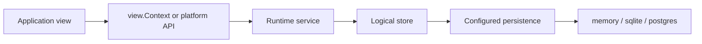

# Runtime DB access

## Overview

This document describes how persistence-backed data is accessed while an FSC
node is running. It covers two different use cases:

- how application code should read or write persisted data from a running view
- how to inspect the live database of a running node for debugging or
  troubleshooting

The following principles apply throughout the runtime:

- FSC runtime data access is **service-oriented**. Application code is expected
  to use View, Fabric, or Chaguar APIs instead of raw SQL connections.
- Not all runtime state is guaranteed to live in a local SQL database. This is
  especially relevant for Chaguar, where state reads are backed by a query
  service.

Related documentation:

- [Database drivers](db-driver.md)
- [Database layout](database-layout.md)
- [View platform configuration](../configuration.md)
- [Shared node configuration](../../../configuration.md)
- [Fabric platform](../../fabric/README.md)
- [Chaguar platform](../../fabric-x/README.md)

## Runtime access paths

The following table summarizes the most common runtime access paths:

| Situation                                       | Recommended entry point                                                        | Typical use case                                                  |
| ----------------------------------------------- | ------------------------------------------------------------------------------ | ----------------------------------------------------------------- |
| Writing a view that depends on persisted data   | `view.Context.GetService(...)`                                                 | Access an application service that is backed by persistence       |
| Reading Fabric state from a view                | `state.GetVault(viewCtx)`                                                      | Read application state from a view                                |
| Working with lower-level Fabric vault functions | `fabric.GetDefaultChannel(viewCtx)`, then `ch.Vault()` on the returned channel | Perform lower-level vault, query, or RWSet work                   |
| Reading Chaguar state                           | `queryservice.GetQueryService(...)` or the channel API                         | Read state through the platform abstraction rather than local SQL |
| Inspecting a live node database                 | `sqlite3` or `psql` in read-only mode                                          | Inspect persisted rows for debugging or troubleshooting           |

## Runtime access layers

At runtime, persistence-backed data flows through the following layers:



These layers have different responsibilities:

- **Runtime service:** the API used by application code during view execution
- **Store:** the persistence-backed abstraction that owns queries and schema
- **Persistence:** the configured backend selection under `fsc.persistences`
- **Backend:** the actual database implementation, such as SQLite or Postgres

Persistence, store and driver are defined in
[Database drivers](db-driver.md#project-terminology).

## Access from a running view

### General rule

Views and application services should prefer the runtime APIs exposed by FSC.
Normal application logic should not be built around direct SQL access.

This reflects the runtime model:

- the runtime already defines store interfaces and higher-level services
- some stores keep in-process caches
- Fabric and Chaguar add their own abstractions on top of the underlying
  database
- not all runtime state is guaranteed to be local SQL state

### View platform

The base View platform wires four persistence-backed stores:

- `KVS`
- `BindingStore`
- `SignerInfoStore`
- `AuditInfoStore`

They are created by the View SDK and backed by the configured persistences, but
the default View SDK does not register all four as global services that every
view can resolve.

In practice, this means:

- the View runtime uses these stores internally
- a custom application can expose additional storage-backed services to views
  through `GetService(...)`
- a plain view should not assume that a KVS instance or SQL handle is available
  through `GetService(...)` by default

If an application needs direct access to a persistence-backed store from a view,
the recommended pattern is:

1. Wrap the store in a dedicated application service
2. Register that service in the application SDK or service registry
3. Retrieve the service through `view.Context.GetService(...)`

### Fabric platform

The Fabric platform is the main place where runtime persisted state becomes an
application-facing API.

There are two common access levels.

#### Simple vault access

Use `state.GetVault(viewCtx)` when you need the application-facing state
service:

```go
func (v *MyView) Call(viewCtx view.Context) (any, error) {
    vault, err := state.GetVault(viewCtx)
    if err != nil {
        return nil, err
    }

    var myState MyState
    if err := vault.GetState(viewCtx.Context(), "mynamespace", "mykey", &myState); err != nil {
        return nil, err
    }

    return myState, nil
}
```

This is the simplest entry point for common Fabric state reads in views.

#### Advanced channel and vault access

Use the channel API when you need lower-level control:

```go
func (v *MyView) Call(viewCtx view.Context) (any, error) {
    _, ch, err := fabric.GetDefaultChannel(viewCtx)
    if err != nil {
        return nil, err
    }

    vault := ch.Vault()
    qe, err := vault.NewQueryExecutor(viewCtx.Context())
    if err != nil {
        return nil, err
    }
    defer qe.Done()

    read, err := qe.GetState(viewCtx.Context(), "mynamespace", "mykey")
    if err != nil {
        return nil, err
    }

    return read, nil
}
```

The channel vault API is richer than the simple `state.Vault` helper. It also
exposes:

- transaction status
- read/write set creation
- read/write set inspection
- envelope storage
- transient data storage

### Chaguar platform

Chaguar behaves differently from Fabric. In practice:

- **Fabric:** runtime state reads are backed by the local vault store
- **Chaguar:** runtime state reads are backed by a remote query service

This means that Chaguar application code should treat runtime state access as a
platform API. It should not assume that application state reads come from local
SQL tables.

In particular:

- common entry points are `queryservice.GetQueryService(...)` and the
  channel/vault API
- the Chaguar vault uses a `QueryService` for state reads
- range queries are not supported by the Chaguar vault query executor
- envelope, metadata, and endorse-tx data are kept in local persistence, but
  Chaguar state queries do not read from local SQL vault tables

Operationally:

- Fabric usually exposes runtime state through a local vault-backed service
- Chaguar should be treated as a query-backed platform API, even if the node
  also persists some local data

## Inspecting a live node database

### When direct DB access makes sense

Direct DB access is useful for:

- verifying that a node is persisting expected data
- checking transaction status during debugging
- inspecting whether state rows exist for a namespace or key
- comparing multiple nodes during troubleshooting

Direct inspection should be treated as **read-only**.

### Locate the active persistence

Each logical store chooses a persistence by name. The persistence definitions
live under `fsc.persistences`; `fsc.persistences.<name>.opts.dataSource` is the
SQLite file path or the Postgres connection string.

Common store-to-persistence mappings are:

- `fsc.kvs.persistence`
- `fsc.binding.persistence`
- `fsc.signerinfo.persistence`
- `fsc.auditinfo.persistence`
- `fsc.envelope.persistence`
- `fsc.metadata.persistence`
- `fsc.endorsetx.persistence`
- `fabric.<network>.vault.persistence`

Example:

```yaml
fsc:
  persistences:
    default:
      type: sqlite
      opts:
        dataSource: /var/lib/fsc/default.sqlite
        tablePrefix: fsc

  kvs:
    persistence: default
  binding:
    persistence: default
  signerinfo:
    persistence: default
  auditinfo:
    persistence: default
  envelope:
    persistence: default
  metadata:
    persistence: default
  endorsetx:
    persistence: default

fabric:
  mynetwork:
    vault:
      persistence: default
```

### Backend types

The three supported backend types are `memory`, `sqlite`, and `postgres`. For
detailed configuration options and behavior, see the
[Database drivers](db-driver.md) and
[Shared node configuration](../../../configuration.md) documentation.

At runtime:

- **memory**: in-memory SQLite, useful for tests but not inspectable after
  process exit
- **sqlite**: local file-based, easiest for local inspection with separate
  read/write handles
- **postgres**: external database, best for shared/remote inspection with a
  single connection pool

### Tables and columns

Table names derive from the persistence's `tablePrefix` (default `fsc`), the
store's parameters and a store-specific suffix. For a network `default` and a
channel `testchannel`, the vault tables are `fsc_default__testchannel_vstate`
and `fsc_default__testchannel_vstatus`. Every table, its columns and the naming
rules are in [Database layout](database-layout.md).

At the `kvs.KVS` API layer, values are typically JSON-marshaled before they are
persisted, so `val` in `fsc_kvs` is often readable JSON. In Fabric-based
applications the main application state is usually in the vault, so `fsc_kvs`
may contain little or no application data. On Postgres, the vault stores `pkey`
as `BYTEA`; inspect it with `encode(pkey, 'escape')`.

### Binary columns

- Payload columns (`val`, `data`, `metadata`) contain binary data that may be
  JSON, protobuf, or encoded bytes
- Use `hex()` or `length()` functions when inspecting binary columns
- Always use read-only access to avoid corrupting the database or invalidating
  caches

## What is safe at runtime

### Safe

- reading tables directly for debugging
- checking whether expected rows were created
- comparing transaction status rows across nodes
- validating that a configured persistence is being used

### Unsafe or unsupported

> [!CAUTION]
>
> - modifying rows manually while the node is running
> - deleting rows from the KVS or vault tables
> - assuming that external DB writes will invalidate FSC caches
> - assuming that Chaguar runtime state is always available in a local SQL
>   database

This matters because:

- the View KVS keeps an in-process cache
- the Fabric vault caches transaction status information
- Chaguar keeps some runtime information in memory and reads state through the
  query service

For SQLite specifically, external live writes are also more likely to cause lock
contention and `SQLITE_BUSY` style failures.
