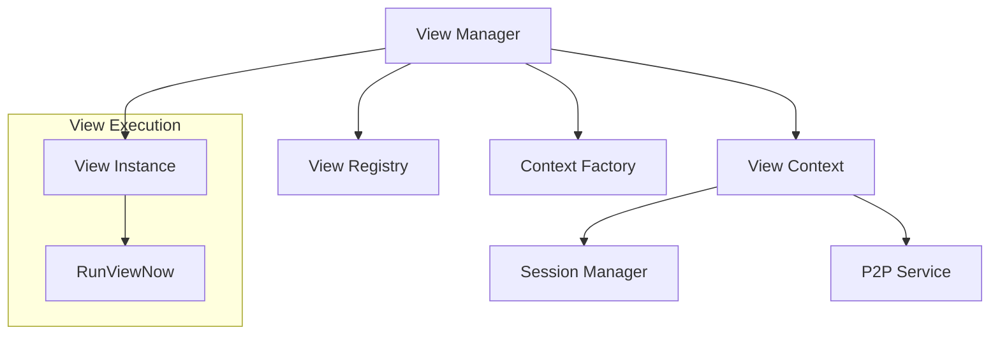
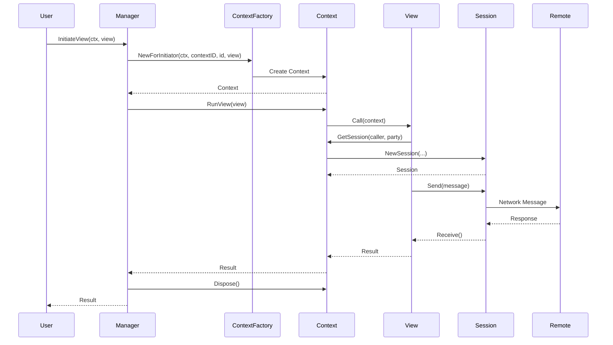
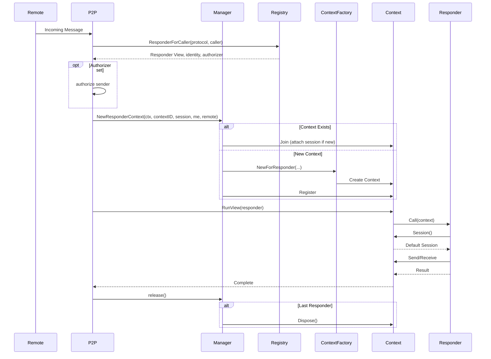
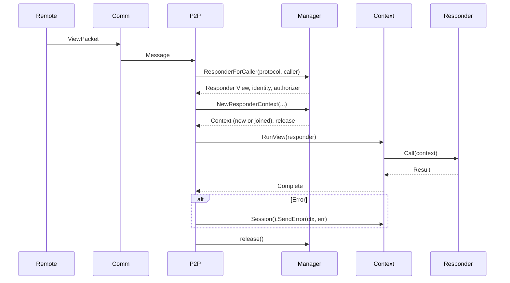

# View Service

The View Service is the core orchestration layer of the Fabric Smart Client (FSC) that manages the lifecycle of views, contexts, and inter-node communication protocols. It provides a high-level abstraction for executing business logic through views while handling session management, identity resolution, and distributed protocol coordination.

## Overview

The View Service enables developers to write business logic as "views" - self-contained units of work that can initiate protocols, respond to requests, and communicate with other FSC nodes. The service manages:

- **View Lifecycle**: Creation, execution, and cleanup of view instances
- **Context Management**: Isolated execution environments for views with session and identity management
- **Protocol Coordination**: Initiator/responder patterns for distributed protocols
- **Session Management**: Multiplexed communication channels between nodes
- **Registry**: Factory pattern for view instantiation and responder registration

## Architecture

### Core Components



#### View Manager

The `Manager` is the central orchestrator responsible for:

- **Context Lifecycle**: Creating, tracking, and disposing view contexts
- **View Instantiation**: Delegating to the registry to create view instances
- **Protocol Initiation**: Starting new protocols as an initiator
- **Responder Coordination**: Creating contexts for incoming protocol requests
- **Metrics**: Tracking active contexts and view executions

**Key Methods:**
- `InitiateView(ctx, view)`: Starts a new protocol with the given view as initiator
- `InitiateContext(ctx, view)`: Creates a context for a view without executing it
- `NewResponderContext(ctx, contextID, session, me, remote)`: Creates or joins a context for responding to a remote request, and returns the func that releases it
- `RegisterFactory(id, factory)`: Registers a factory for creating views by ID
- `RegisterResponder(responder, initiatedBy)`: Registers a responder view for a given initiator

#### View Context

The `Context` provides the execution environment for views, implementing the `view.Context` interface:

**Identity & Session Management:**
- `Me()`: Returns the local identity bound to this context
- `IsMe(id)`: Checks if an identity is local to this node
- `Session()`: Returns the default session (for responders)
- `GetSession(caller, party)`: Gets or creates a session to a remote party
- `GetSessionByID(id, party)`: Gets a session by explicit ID

**Service Access:**
- `GetService(type)`: Retrieves services (local context-scoped or global)
- `PutService(service)`: Registers a service in the local context scope

**View Execution:**
- `RunView(view, opts...)`: Executes a view within this context
- `Initiator()`: Returns the initiator view (if this is an initiator context)

**Lifecycle:**
- `OnError(callback)`: Registers cleanup callbacks for error handling
- `Dispose()`: Releases all resources (sessions, callbacks)

#### Context Factory

The `ContextFactory` creates view contexts with proper initialization:

- `NewForInitiator(ctx, contextID, id, view)`: Creates a context for an initiator view
- `NewForResponder(ctx, contextID, me, session, remote)`: Creates a context for a responder view

The factory wires together:
- Service provider (global services)
- Session factory (for creating communication sessions)
- Endpoint service (for identity resolution)
- Identity provider (for local identities)
- Tracer (for observability)

#### View Registry

The `Registry` manages view factories and responder mappings:

**Factory Registration:**
- `RegisterFactory(id, factory)`: Maps a view ID to a factory
- `NewView(id, input)`: Creates a view instance using the registered factory

**Responder Registration:**
- `RegisterResponder(responder, initiatedBy)`: Maps an initiator to a responder view
- `RegisterResponderWithIdentity(responder, id, initiatedBy)`: Maps with a specific identity
- `RegisterResponderWithOptions(responder, initiatedBy, opts...)`: Maps with `WithIdentity`,
  `WithAuthorizer` (see [Authorizing responders](../programming-model.md#authorizing-responders))
  and `WithProtocol` (see [Protocol names](../programming-model.md#protocol-names))
- `GetResponder(initiatedBy)`: Retrieves the responder for an initiator
- `ResponderForCaller(protocol, caller)`: Returns the responder, identity and authorizer for a
  protocol name or, if none is registered under it, for a caller ID
- `ExistResponderForCaller(caller)`: `ResponderForCaller` without the authorizer

The identity and authorizer are kept per initiator, so one responder can answer several initiators
with a different identity and authorizer for each. Registering again for an initiator replaces its
responder and identity, and its authorizer and protocol name only if the new registration sets
them.

**View Identification:**
- Uses reflection to generate unique identifiers: `<package>/<type>`
- Caches identifiers for performance

#### Session Manager

The `Sessions` component manages communication sessions within a context:

- **Session Caching**: Sessions are cached by `(viewID, partyID)` tuple
- **Session Reuse**: Existing open sessions are reused when possible
- **Session Lifecycle**: Tracks session state (open/closed)
- **Default Session**: Responder contexts have a default session from the initiator

**Key Operations:**
- `Put(viewID, party, session)`: Caches a session
- `Get(viewID, party)`: Retrieves a cached session
- `GetFirstOpen(viewID, parties)`: Finds the first open session from a list of party identities
- `Reset()`: Clears all sessions

## View Lifecycle

### Initiator Flow



**Steps:**

1. **Initiation**: User calls `Manager.InitiateView(ctx, view)`
2. **Context Creation**: Manager creates a new context via `ContextFactory.NewForInitiator`
3. **Context Registration**: Manager registers the context in its internal map
4. **View Execution**: Manager calls `Context.RunView(view)` which invokes `view.Call(context)`
5. **Session Creation**: View requests sessions via `context.GetSession(caller, party)`
6. **Communication**: View sends/receives messages through sessions
7. **Completion**: View returns result
8. **Cleanup**: Manager calls `context.Dispose()` and removes context from map

### Responder Flow



**Steps:**

1. **Message Arrival**: P2P service receives an incoming message
2. **Responder Lookup**: P2P queries `Registry.ResponderForCaller` to find the responder view; if it has an authorizer, the authorizer must accept the sender before a context or session is created
3. **Context Resolution**: P2P calls `Manager.NewResponderContext` to create a context, or to join the context with that ID if one exists
4. **View Execution**: P2P runs the responder view in the context
5. **Session Access**: Responder accesses the default session via `context.Session()`
6. **Communication**: Responder sends/receives messages through the session
7. **Completion**: Responder returns result
8. **Cleanup**: P2P calls the release func; the context is disposed when its last responder releases it

Several responders can run in one context, for example when a node receives two sessions of the same protocol. Each responder runs on its own go context, so that one responder returning does not cancel another. The shared context, and every session registered in it, lives until the last responder releases it, either by returning or because its go context is done.

## Context Types

### Parent Context

The `Context` struct is the main implementation of `view.Context` and `ParentContext`. It provides:

- Full context functionality
- Session management
- Service provider integration
- Error callback registration
- Cleanup and disposal

### Child Context

The `ChildContext` wraps a parent context to provide:

- **Session Override**: Can override the default session
- **Initiator Override**: Can override the initiator view
- **Error Callbacks**: Maintains its own list of error callbacks
- **Delegation**: Delegates most operations to the parent

**Use Cases:**
- Running a view with a different session
- Temporarily acting as an initiator from a responder context
- Isolating error handling for nested view executions

### Wrapped Context

The `WrappedContext` wraps a parent context to provide a different `context.Context`:

- Overrides the Go context while delegating all other operations
- Used for propagating cancellation, deadlines, and trace spans
- Maintains the same view context semantics

## Session Management

### Session Lifecycle

1. **Creation**: Sessions are created via `SessionFactory.NewSession` or `NewSessionWithID`
2. **Caching**: Sessions are cached in the context's `Sessions` manager
3. **Reuse**: Existing open sessions are reused when `GetSession` is called
4. **Closure**: Sessions are closed when the context is disposed
5. **Cleanup**: Session factory deletes each session by its ID and remote PKID

### Session Scoping

Sessions are scoped by:
- **View ID**: The identifier of the calling view
- **Party ID**: The identity of the remote party

This allows different views to have independent sessions to the same party.

### Session Resolution

When `GetSession(caller, party)` is called:

1. Check for cached session by `(viewID, party)`
2. If found and open, return it
3. If not found, resolve the party identity:
   - Try the party identity as-is
   - Try resolving via endpoint service
   - Try resolving as a label via identity provider
4. Create a new session to the resolved identity
5. Cache and return the session

## View Execution

### RunViewNow

The `RunViewNow` function is the core view execution engine:

```go
func RunViewNow(parent ParentContext, v View, opts ...view.RunViewOption) (any, error)
```

**Execution Flow:**

1. **Option Compilation**: Parse run options (AsInitiator, AsResponder, SameContext, etc.)
2. **Context Selection**: Use parent context or create a child context based on options
3. **Tracing**: Start a new trace span for the view execution
4. **Context Creation**:
   - If `SameContext`: Wrap parent with new Go context
   - If `AsInitiator`: Create child context with initiator set
   - Otherwise: Create child context with optional session override
5. **Panic Recovery**: Wrap execution in defer/recover to handle panics
6. **View Invocation**: Call `view.Call(context)` or execute the provided call function
7. **Error Handling**: On error, call `context.Cleanup()` to invoke error callbacks
8. **Result Return**: Return the view's result

### Run Options

- `AsInitiator()`: Run as an initiator (sets `context.Initiator()`)
- `AsResponder(session)`: Run as a responder with a specific session
- `WithViewCall(func)`: Execute a function instead of `view.Call`
- `WithSameContext()`: Run in the parent view context instead of creating a child view context
- `WithContext(ctx)`: Use the Go context `ctx` and run in the parent view context (implies `WithSameContext()`)
- `WithGoContext(ctx)`: Use the Go context `ctx` in a new child view context

### Helper Functions

- `Initiate(context, view)`: Shortcut for initiating a new protocol
- `AsResponder(context, session, func)`: Temporarily act as a responder
- `AsInitiatorCall(context, initiator, func)`: Temporarily act as an initiator
- `RunCall(context, func)`: Execute a function as a view

## Error Handling

### Error Callbacks

Contexts support registering error callbacks via `OnError(callback)`:

- Callbacks are invoked when a view execution fails or panics
- Callbacks are invoked in registration order
- Callbacks are protected by panic recovery
- Useful for resource cleanup (closing files, releasing locks, etc.)

### Cleanup Process

When a view execution fails:

1. `RunViewNow` catches the error or panic
2. Calls `context.Cleanup()` to invoke all error callbacks
3. Returns the error to the caller

When a context is disposed:

1. `Manager.DeleteContext` is called, or the last responder in a responder context releases it
2. Calls `context.Dispose()` to release resources
3. Closes each session instance the context holds, so a newer session with the same ID and party is not affected
4. Removes the context from the manager's map

### Panic Recovery

All view executions are wrapped in panic recovery:

- Panics are caught and converted to errors
- Stack traces are logged
- Error callbacks are still invoked
- The error is returned to the caller

## Service Provider

### Global Services

The context has access to global services via `services.Provider`:

- Registered at the application level
- Shared across all contexts
- Retrieved via `context.GetService(type)`

### Local Services

Each context has a local `ServiceProvider`:

- Scoped to the context
- Registered via `context.PutService(service)`
- Retrieved first before checking global services
- Useful for context-specific dependencies (e.g., web streams)

### Service Resolution

When `GetService(type)` is called:

1. Check local service provider
2. If found, return it
3. If not found, check global service provider
4. Return error if not found in either

## Remote View API Access Control

The remote view API (gRPC and HTTP, see [View Service over HTTP](view-service-http.md)) passes
every command through one `server.PolicyChecker`, on unary and stream calls alike. The server
calls it after validating the header and the binding to the client TLS certificate, and before
the replay check, so a refused command is not remembered as accepted. The view SDK builds that
checker from two parts:

1. `server.AccessControlChecker` accepts a command only if its creator is the node's identity or
   one of `fsc.view.remote.clients`, and its signature verifies under that identity. A command it
   refuses goes no further.
2. Every checker in the dig value group `fsc-view-policy-checkers` must then accept it. The first
   error refuses the command.

No group checker is registered by default, so every authenticated client may call every view. An
application narrows that by providing a `PolicyCheckerEntry` from its SDK's `Install`. This one
lets each creator call only the views listed for it, refuses view calls from a creator it does
not list (the node's own identity included, so list it if local tools call views remotely), and
lets other commands through:

```go
// Creator identity (the header's serialized identity, the PEM certificate for an X.509 client,
// as a string) -> the views it may call.
type viewACL map[string][]string

func (a viewACL) Check(_ *protos.SignedCommand, c *protos.Command) error {
	call := c.GetCallView()
	if call == nil {
		return nil // not a view call
	}
	if slices.Contains(a[string(c.GetHeader().GetCreator())], call.GetFid()) {
		return nil
	}
	return errors.Wrapf(view.ErrDenied, "view [%s] not allowed", call.GetFid())
}

func (s *MySDK) Install() error {
	if err := s.Container().Provide(func() viewsdk.PolicyCheckerEntry {
		return viewsdk.PolicyCheckerEntry{Checker: viewACL{ /* ... */ }}
	}); err != nil {
		return err
	}
	return s.SDK.Install()
}
```

Rules for a group checker:

- `Command.Payload` is a oneof. A checker that governs only view calls lets commands with no
  `CallView` through; one that governs other command types handles them explicitly.
- dig does not keep the order of a group. Checkers must not depend on running before or after
  each other; since all of them must accept, their order does not change the outcome.
- A refusal wraps `view.ErrDenied`, which the view service counts as `requests_rejected` with
  reason `denied`. `errors.Is(err, view.ErrDenied)` holds only on the node: the client receives the
  error text in the response and reports it wrapped in `view.ErrViewExecutionFailed`.
- `Check` may be called concurrently. A command it accepts may still be refused by the replay
  check, so it must not assume an accepted command runs.

The group is the supported extension point. A decorator of the `server.PolicyChecker` binding
receives the SDK's checker and returns the one the view service uses instead, so the access
control checker runs only if the decorator calls it, and dig allows one decorator of the binding
per container.

### Concurrent commands

`fsc.view.remote.maxConcurrentRequests` bounds the commands the remote view API runs at once,
across gRPC and HTTP. The server takes a slot after the policy check, so only authenticated
callers hold one, and before the replay check, so a command refused as busy can be sent again
unchanged. A refused command ends with gRPC `Unavailable` (HTTP `503`, WebSocket close `1013`)
and is counted as `requests_rejected` with reason `busy`. The bound is per node: one client can
hold every slot. See [configuration](../../../configuration.md).

## Integration with P2P Service

The View Service integrates with the P2P Service for handling incoming messages:

### P2P Service Responsibilities

1. **Message Reception**: Listens on the master session for incoming messages
2. **Responder Lookup**: Queries the registry for the appropriate responder view
3. **Context Creation**: Calls `Manager.NewResponderContext` to get or create a context
4. **View Execution**: Runs the responder view in the context
5. **Error Handling**: Sends error messages back to the initiator on failure
6. **Release**: Releases the context when the responder returns

The text sent is the raw error returned by the responder view (`err.Error()`), forwarded unmodified via `Session().SendError(context.WithoutCancel(viewCtx.Context()), ...)`. The runtime does not inspect or filter it — deciding what information is safe to disclose to a remote, potentially untrusted caller is the responder view's responsibility, not the P2P service's. See the [View API](../view-api.md#send-and-receive) for guidance on what responder views should and shouldn't return as errors.

### Message Flow



## Best Practices

### View Development

1. **Keep Views Focused**: Each view should have a single, well-defined purpose
2. **Use Sessions Wisely**: Cache sessions when possible, but be aware of their scope
3. **Handle Errors Gracefully**: Use `OnError` callbacks for cleanup
4. **Avoid Long-Running Operations**: Views should complete in a reasonable time
5. **Use Tracing**: Leverage the built-in tracing for observability

### Context Management

1. **Always Dispose**: Ensure contexts are disposed when no longer needed
2. **Use Child Contexts**: For nested view executions or temporary role changes
3. **Register Services Locally**: Use local services for context-specific dependencies
4. **Avoid Context Leaks**: The manager tracks contexts; ensure they're deleted

### Session Management

1. **Reuse Sessions**: Let the context cache and reuse sessions
2. **Close Explicitly**: Call `session.Close()` when done (or rely on context disposal)
3. **Handle Session Errors**: Sessions can fail; handle errors appropriately
4. **Understand Scoping**: Sessions are scoped by view and party

### Error Handling

1. **Register Cleanup Callbacks**: Use `OnError` for resource cleanup
2. **Handle Panics**: The framework recovers panics, but avoid them when possible
3. **Log Errors**: Use the logger for debugging
4. **Return Meaningful Errors**: Provide context in error messages

## Configuration

The View Service is configured through the FSC configuration file. Key settings include:

- **Identity Configuration**: Default identity and identity provider settings
- **Session Configuration**: Session factory and communication layer settings
- **Tracing Configuration**: OpenTelemetry tracing provider settings
- **Metrics Configuration**: Prometheus metrics provider settings

See the [Configuration Guide](../../../configuration.md) for detailed configuration options.

## Observability

### Metrics

The View Service exports Prometheus metrics, among them:

- `fsc_view_services_view_contexts`: Current number of active contexts (gauge)
- `fsc_shutdown_draining`: 1 while the node drains running views before it stops (gauge)
- `fsc_view_services_view_p2p_rejections{reason}`: First P2P messages the node refused (counter)
- `fsc_view_services_view_grpc_server_requests_rejected{reason}`: View API commands the server refused (counter)

The full list, with labels and operational notes, is in the [Metrics Catalog](monitoring_metrics.md).

### Tracing

The View Service integrates with OpenTelemetry for distributed tracing:

- Each view execution creates a new span
- Spans include attributes: `view`, `initiator_view`, `success`
- Spans are linked to parent spans for nested view executions
- Trace context is propagated across network boundaries

### Logging

The View Service uses structured logging:

- Debug logs for view lifecycle events
- Info logs for important state changes
- Error logs for failures and panics
- Context-aware logging with trace IDs

## Code References

| Component | File Path |
| :--- | :--- |
| View Manager | `platform/view/services/view/manager.go` |
| View Context | `platform/view/services/view/context.go` |
| Context Factory | `platform/view/services/view/context.go` |
| Child Context | `platform/view/services/view/child.go` |
| View Registry | `platform/view/services/view/registry.go` |
| Session Manager | `platform/view/services/view/sessions.go` |
| View Execution | `platform/view/services/view/view.go` |
| Service Provider | `platform/view/services/view/sp.go` |
| P2P Service | `platform/view/services/view/p2p/service.go` |
| Error Definitions | `platform/view/services/view/errors.go` |
| Remote view service (gRPC) | `platform/view/services/view/grpc/server/` |
| Remote view service (HTTP binding) | `platform/view/services/view/web/` |

## Related Documentation

- [View Service over HTTP](./view-service-http.md) - The view service's HTTP binding
- [Communication Service](./comm/readme.md) - P2P communication layer
- [View SDK](../view-sdk.md) - High-level view development guide
- [Configuration Guide](../../../configuration.md) - FSC configuration reference
