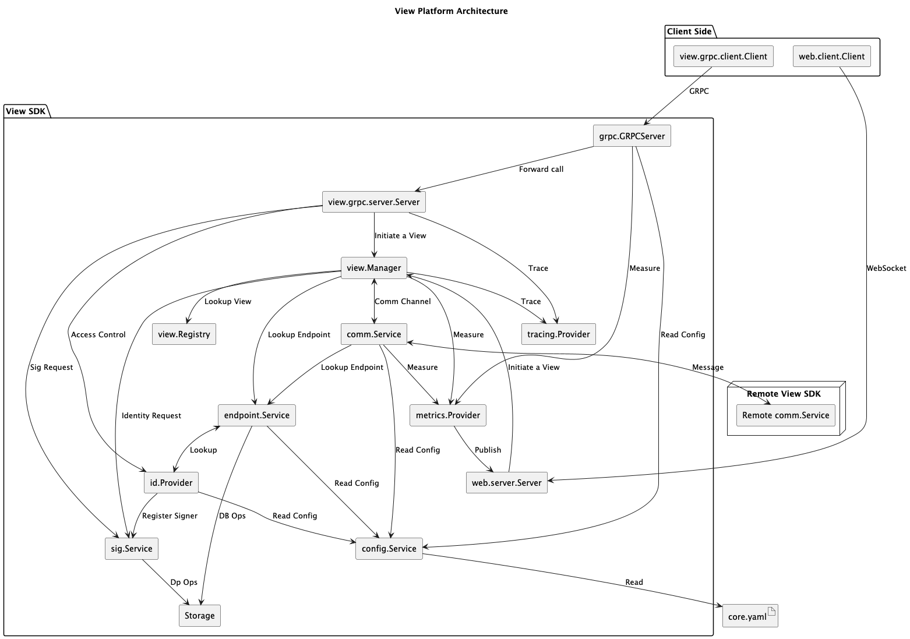

# The View SDK

The View SDK is the base runtime platform of FSC. It provides the public programming contracts used by views and the runtime services that execute them:

- the public View programming API in `platform/view/view`;
- the runtime implementation in `platform/view/services/...`;
- the configuration, communication, persistence, and observability services required to run FSC views.

This is the architecture of the View SDK:

The pages for each service are listed in the [View platform](README.md) overview.
