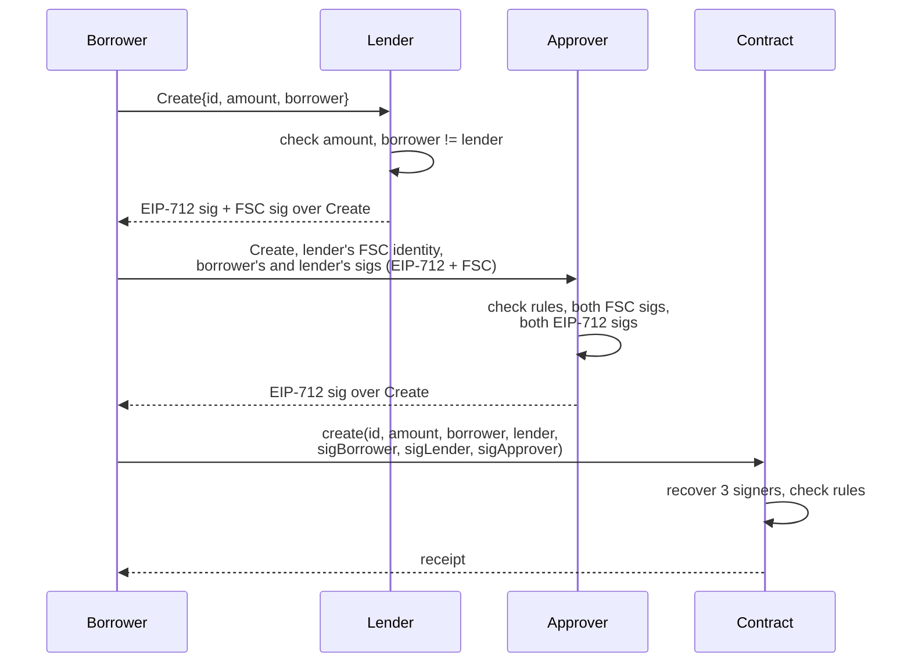

# IOU demo on EVM networks

This suite runs the IOU life cycle from
[`integration/fabric/iou`](../../integration/fabric/iou) again, but the agreed
state lands in a Solidity contract on an EVM chain instead of a Fabric
namespace. The FSC side does not change: the borrower, the lender and an
approver still exchange sessions and signatures the way the Fabric IOU's views
do. What changes is who enforces the result: instead of chaincode, an EVM
contract checks the signatures and applies the create or update itself.

The suite runs against a disposable Besu development node in CI. The same code
also reaches a Hiero network, local or hosted, through configuration; see
[Running against Hiero](#running-against-hiero).

## Roles

- **borrower** creates and updates IOUs. It is the only node with funds: it
  submits every transaction, pays its gas, and waits for the receipt.
- **lender** is owed the IOU. It checks every proposal against the IOU rules
  before it signs.
- **approver1** and **approver2** are the two addresses the contract accepts
  as an approver. Either one can approve a create or an update; the suite uses
  both, in different specs, to show that both are accepted.

Each FSC node holds two keys: its usual FSC identity, used on sessions, and a
generated secp256k1 key, used to sign and submit EVM transactions. The two are
unrelated except where the protocol binds them together (see
[Why the lender signs twice](#why-the-lender-signs-twice)).

## Creating an IOU



The borrower picks a random id and proposes `Create{id, amount, borrower}` to
the lender. The lender fills in its own address, checks the amount and that
borrower and lender differ, and signs the completed struct twice: once with
its EVM key (EIP-712, the signature the contract will check) and once with its
FSC identity, over the same digest. The borrower signs the same way and
forwards everything to the approver it was told to use: the struct, the
lender's FSC identity, and all four signatures.

The approver re-runs the IOU rules in Go, checks the borrower's FSC signature
against the identity on the session and the lender's against the forwarded
identity, checks both EIP-712 signatures recover to the addresses in the
struct, and checks the id is unused. If everything holds, it replies with its
own EIP-712 signature. The borrower submits `create(...)` with the three
EIP-712 signatures and waits for the receipt.

An update follows the same shape with `Update{id, amount, version}`, without
the FSC signatures: the borrower and lender are already on chain, so there is
nothing left to bind an identity to. The borrower reads the current version
and owners with `get(id)` first, and the lender and approver do too before
they sign, so nobody signs an update against state it has not checked.

## What the contract checks

[`IOU.sol`](iou/contract/IOU.sol) stores one entry per id: amount,
borrower, lender, version. `create` and `update` apply only when:

- the id is unused (`create`) or exists (`update`)
- the amount is at least 5 (`create`) or strictly lower than the stored amount
  (`update`)
- borrower and lender differ (`create`); an update reuses the stored pair
- the version starts at 1 (`create`) or matches the stored version, then
  increments (`update`)
- the borrower, the lender and one of the configured approvers have each
  signed the exact struct being applied, with EIP-712 signatures that recover
  to the three different addresses

The EIP-712 domain binds every signature to the chain id and the deployed
contract's address, so a signature from one network or one deployment cannot
be replayed on another. The version in `Update` does the same job for replay
within one contract: a signature over `Update{id, 5, 1}` cannot be reused once
the stored version has moved to 2.

### Why the lender signs twice

The EIP-712 signature is what the contract checks on chain; it says nothing
about which FSC party produced it, since any address can sign any message.
Without a second check, a borrower could forward a lender address it
generated and controls itself, and the contract would accept it as a valid
"lender" who never participated.

The FSC signature closes that gap: the approver already knows the borrower's
FSC identity, since it is on the session the request came in on, and it
resolves the forwarded lender identity through the endpoint service's
resolvers, which rejects an identity nobody told it about (see
[`checkLenderID`](iou/views/fsc.go)). It then verifies the FSC
signature over the same EIP-712 digest with that identity's FSC verifier. A
forged lender identity fails resolution; a known FSC peer that did not
actually sign the Create fails verification. Either way, the lender the
approver accepts is a known FSC peer that signed this Create, not an address
the borrower generated and controls itself.

## Running on Besu

```bash
make pull-images-evm
make integration-tests-examples-evmiou
```

`nwo` starts a Besu development node (instant mining, chain id 1337), generates
a secp256k1 key per FSC node, funds the borrower, deploys `IOU.sol` with
approver1 and approver2 as the approver set, and writes the endpoint, chain id,
contract address and key path into each node's `core.yaml`, under `evm`. See
[Development Guide → EVM](../../docs/dev/development.md#evm) and
[Integration tests](../../docs/dev/integration-tests/README.md) for the
target and what it covers.

## Running against Hiero

The same suite runs against any EVM endpoint, Hiero included, given an
endpoint, a chain id and a funded key:

```bash
export EVM_ENDPOINT=http://localhost:7546
export EVM_CHAIN_ID=298
export EVM_FUNDER_KEY=<hex-encoded ECDSA private key>
make integration-tests-examples-evmiou
```

With all three set, `nwo` validates that the endpoint's chain id matches
`EVM_CHAIN_ID` and skips Besu entirely: the borrower is funded from
`EVM_FUNDER_KEY` instead of Besu's dev account, and the contract is deployed on
the network at `EVM_ENDPOINT`.

| Setting | Besu dev (CI) | Hiero local node | Hiero testnet |
| --- | --- | --- | --- |
| `EVM_ENDPOINT` | set by `nwo` | `http://localhost:7546` | a testnet relay URL |
| `EVM_CHAIN_ID` | 1337 | 298 | 296 |
| `EVM_FUNDER_KEY` | Besu's dev key | a local-node ECDSA account | your funded ECDSA key |

The gas multiplier (default 1.2), the receipt poll interval (default 1s) and
the finality timeout (default 1m) are not environment variables: they are set
on `evmTopology` in [`topology.go`](topology.go). A run against Hiero, where
the mirror node that answers `eth_getTransactionReceipt` lags consensus by a
few seconds, should raise the timeout; two minutes is a safe margin for a
local node or testnet.

Starting a [Hiero local node][hiero-local-node] prints three tables of
pre-funded accounts. Use a private key from the "Alias ECDSA" table as
`EVM_FUNDER_KEY`: those accounts already have an EVM address and 10,000 ℏ, and
the [JSON-RPC relay][hiero-relay-config] listens on port 7546 by default,
matching the table above.

> [!NOTE]
> Hiero bills a transaction for the gas it actually used and refunds the rest
> of the submitted gas limit ([Gas Fees][hiero-gas-fees], under "Gas
> Reservation and Unused Gas Refund"), since [HIP-1249] removed the network's
> earlier minimum charge. The Besu default multiplier works equally well on
> Hiero.

Funding a borrower's freshly generated address on Hiero with a plain transfer,
the way `nwo` funds it in Besu mode, creates a "hollow" account: one with a
balance and no key, unable to send a transaction of its own until the matching
ECDSA key signs one ([Auto Account Creation][hiero-auto-account], under
"Complete a Hollow Account"). The borrower's first `create` or `update`
completes it; nothing in the demo has to wait for that explicitly, since the
borrower only sends after it already holds funds and a key.

[hiero-local-node]: https://github.com/hiero-ledger/hiero-local-node
[hiero-relay-config]:
  https://github.com/hiero-ledger/hiero-json-rpc-relay/blob/main/docs/configuration.md
[hiero-gas-fees]:
  https://docs.hedera.com/hedera/core-concepts/smart-contracts/gas-and-fees
[hiero-auto-account]:
  https://docs.hedera.com/hedera/core-concepts/accounts/auto-account-creation
[HIP-1249]: https://hips.hedera.com/hip/hip-1249

## Comparing with the Fabric IOU

The business rules are the same ones
[`integration/fabric/common/iou`](../../integration/fabric/common/iou) enforces,
and the lender and the approver check them in Go either way. What differs is
where the decision becomes binding and who needs funds:

- The Fabric IOU's approver endorses a transaction that the borrower submits
  to the ordering service; the committer applies it once the endorsement
  policy is satisfied. This demo's approver signs an EIP-712 message instead,
  and the contract itself recovers and checks that signature when the
  borrower submits.
- Fabric's endorsement already carries the endorser's MSP identity, so the
  chaincode never needs to be told who the lender is. The EVM contract only
  sees addresses, which is why this demo adds the lender's second, FSC
  signature: without it, nothing on chain would tie the lender's EIP-712
  signature back to an actual FSC party.
- The Fabric IOU's borrower node needs no funds of its own; ordering and
  endorsement costs are the organization's, not a per-transaction balance on
  the submitter. Here the borrower pays gas for every `create` and `update`,
  so it is the only node `nwo` funds.

## Limits

This is a demo: the EVM-facing code lives entirely under `examples/evmiou/`, and
nothing under `platform/` knows it exists. Keeping it small enough to run as
one CI job leaves out a few things a production integration would need:

- There is no vault, committer or finality listener on the EVM side; views
  read and write the chain directly over JSON-RPC.
- The suite covers one network at a time, with no replicas, alternate
  databases, TLS or the metrics and tracing checks the Fabric IOU suite also
  runs.
- Hiero is documented and run by hand, as shown above, but it does not run in
  CI.
- Nothing here touches Hiero's native services (HTS, HCS) or the Hiero Go SDK;
  the demo only ever speaks plain JSON-RPC.
- There is no reorg handling, since both Besu's dev mode and Hiero finalize a
  transaction immediately, with no fork to roll back from.
